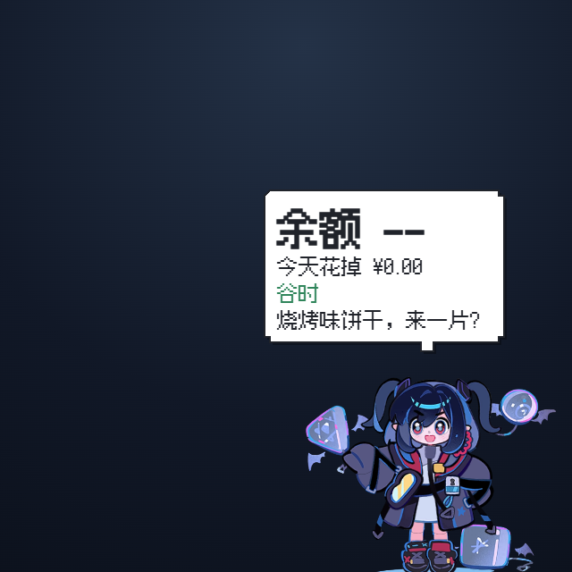
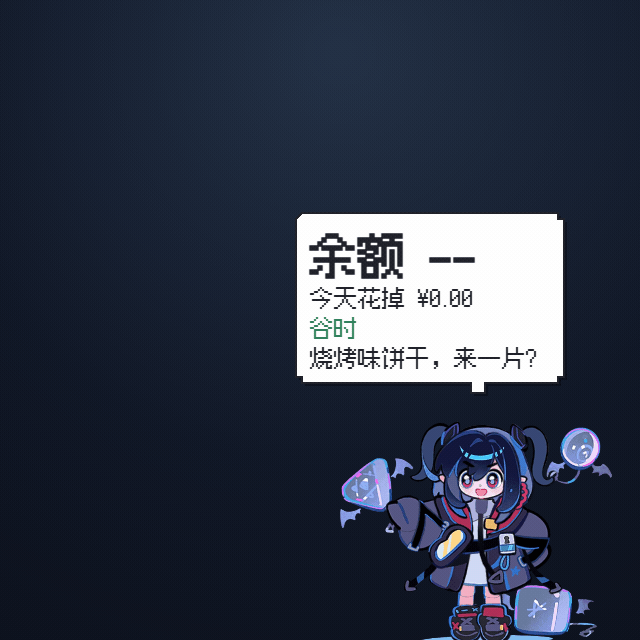

<div align="center">


<br />

[](LICENSE)
[](https://github.com/deepseek-ai/deepseek-harness)
[](#效果预览)
[](#语音与文案)
[](#开发与验证)

</div>

给 DeepSeek Harness 界面加一只可露希尔桌宠：透明视频动作切换、像素风格气泡、实时计费与余额提醒，以及可编辑的台词与语音。

<div align="center">
  
</div>

> [!WARNING]
> **版权与使用边界**：本插件属于个人二次创作，角色形象取自《明日方舟》游戏截图，音效借用自游戏内音频，相关权利归原权利人所有；自行制作的透明动画与本仓库代码可按 MIT 许可证使用，但角色形象、音效及衍生素材**仅限个人本机娱乐使用**，对外再分发前请自行确认权利。字体使用 **Ark Pixel**（遵循 SIL OFL 1.1，见 `assets/fonts/OFL.txt`）。完整说明见 [`NOTICE.md`](NOTICE.md)。

---

## 快速开始

### 1. 从仓库安装

在 **Plugins → Add plugin** 中填入仓库地址：

```text
[https://github.com/fengshiyangrouguan/dsh-closure-pet](https://github.com/fengshiyangrouguan/dsh-closure-pet)
```

或者手动编辑对应 profile 的 `package.json`，添加依赖并将插件名写入 `dsh.profile.bundles`：

```json
{
  "dependencies": {
    "dsh-closure-pet": "github:fengshiyangrouguan/dsh-closure-pet"
  },
  "dsh": {
    "profile": {
      "bundles": ["dsh-closure-pet"]
    }
  }
}
```

### 2. 本地开发安装

将依赖指向本地目录，同样需要加入 `dsh.profile.bundles`：

```json
{
  "dependencies": {
    "dsh-closure-pet": "link:<本地路径>/dsh-closure-pet"
  },
  "dsh": {
    "profile": {
      "bundles": ["dsh-closure-pet"]
    }
  }
}
```

### 3. 卸载方式

1. 在插件管理中停用插件（客户端 bundle 会随之卸载；若改过宿主代码，按需重启 DSH）。
2. 从 profile 的 `dependencies` 和 `dsh.profile.bundles` 中删除 `dsh-closure-pet`。
3. 如需清理配置与当日花费记录，可手动删除 `$DSH_HOME/.dshcl.json`。

---

## 核心功能

### 动画状态机与表现

* **基础状态与转场**：内置 `idle`、`sad`、`think` 三种基础状态，均配有独立 `loop`、`enter` 与 `exit` 槽位。状态切换通过 `Sad_Begin` / `Think_Begin` 正放进入、倒放退出，`sad` 与 `think` 之间经由 `idle` 中转，跨多段转场时自动调整倍速，离开 `idle` 前会等当前循环走完一轮。
* **事件与通知联动**：监听 `agent/assistant-stream`、`tools/result`、`agent/error`、`agent/status`、`session/event`（`assistant/message` 计费、`turn/end` 结束）及每 60 秒一次的账户余额轮询。事件可绑定单段或多段视频（均匀随机抽取），并携带 `notice` 实例动态组装文案与气泡。
* **开屏检定**：拿到 `/state` 后默认延迟 5 秒（可通过 `localStorage['dshcl-startup-delay']` 调整）执行一次峰谷检定，走常规事件管线触发 `peak_time` 或 `valley_time`，若余额偏低则将 `lowBalance`（优先级 20，纯文本通知）排入队列提示。
* **独立状态机**：取消历史跨函数状态标记（如 `talkLock`、`startupHold`、`enteringSad`、`afterOverlay`），统一由单一 active 片段、`seq` 与纯 `resolve()` 驱动。详细设计见 [`docs/state-machine.md`](docs/state-machine.md)。

### 计费、峰谷时段与余额提醒

* **计费公式**：按 `assistant/message` 的 `usage` 计算单条消息花费：
  $$\text{花费} = \text{cacheRead} \times \text{谷/峰价} + \text{input} \times \text{未命中价} + \text{output} \times \text{输出价}$$
  价目（每百万 token，`[谷价, 峰价]`）内置于 `lib/index.js`，当日累计花费与设置一并持久化至 `$DSH_HOME/.dshcl.json`。
* **峰谷判定（北京时间）**：
  * **峰价时段**：工作日 `09:00–12:00`、`14:00–18:00`。
  * **谷价时段**：其余时间、周末及法定节假日全天。
* **节假日表维护**：闭区间表位于 `lib/index.js` 的 `HOLIDAY_RANGES`（当前收录 2026 全年与 2027 推定日期）。官方公布次年调休安排后更新对应区间即可；未收录年份会退化为仅按工作日与周末计算，此时 `/state` 中 `holidaysOutdated` 会置为 true 以便提醒更新。

### 语音与文案

* **预生成语音**：中文原台词与日语翻译均预生成为 OGG 文件存放于 `assets/voice/`，通过 `manifest.json` 映射至中文原文。开启语音后气泡按 **语音时长 + 2 秒** 停留，无语音时按可见字符数计算（最短 4.2 秒），运行时无需加载 CosyVoice。
* **可编辑台词库**：DSH 设置页支持调整余额不足阈值、闲时对话间隔，并分别维护 `Idle`、`Sad_Idle`、`Think_Idle` 闲时池及各事件对话池（初始值来自 `assets/src/config/dialogues.json`）。

### 交互、设置与运行开销

* **拖拽防误触锁定**：按下桌宠后在 window 捕获阶段拦截 `pointerdown`、`mousedown`、`selectstart`、`dragstart`，为 `<html>` 加上 `dshcl-dragging` 样式（`user-select:none`、`cursor:grabbing`），并铺设 `#dsh-closure-pet-drag-shield` 遮罩层防止点穿或被 iframe 抢焦点；松手后吞掉单次合成 `click`，失焦、切后台或 `pointercancel` 时自动清理。
* **桌面右键设置**：支持镜像翻转、缩放大小、吸附强度（`0%–200%`，`0%` 关闭）、气泡开关与大小（`50%–200%`）、分级字体排版（默认开启）、透明度、音效开关/音量，以及语音开关、语言（中文/日语）与独立音量。入口与完整设置项见[设置入口](#设置入口)。
* **轻量渲染**：角色由浏览器直接解码 `888×748` 的 WebM VP9-Alpha 视频，不再逐帧重绘，也不依赖 WebGPU；页面隐藏时暂停视频播放，并将状态轮询间隔从 1 秒放宽至 5 秒。

### 设置入口

桌宠有两套设置，入口和用途不同：

| 入口 | 打开方式 | 主要设置项 |
|---|---|---|
| 桌宠右键面板 | **右键点击桌宠本体** → 设置 | 镜像翻转、大小、吸附强度、气泡开关、气泡大小、分级字体排版、透明度、音效开关/音量、语音开关、语音语言（中文/日语）、语音音量；底部还有「重置位置」和「完成」 |
| DSH 设置页 | **DSH 设置 → 可露希尔桌宠**（不是右键面板） | 余额不足阈值、闲时对话间隔、闲时对话触发概率；`Idle` / `Sad_Idle` / `Think_Idle` 闲时对话池；到账、峰时、谷时、余额不足、对话中断、出错、工具成功、本轮结束等特殊事件对话池；点击交互对话池（通用池 + `Idle` / `Sad_Idle` / `Think_Idle` 三种状态池）；底部「关闭」 |

点击交互时，从**通用池 + 当前基础状态对应的状态池**合并抽取：`Idle` 状态用 `interactIdle`，`Sad_Idle` 用 `interactSadIdle`，`Think_Idle` 用 `interactThinkIdle`。三个状态池最初是从对应闲时对话池增量复制的，可以分别编辑。

右键面板适合临时的显示与声音调整；DSH 设置页适合低频的计费阈值、闲时节奏和台词库维护。两处修改都会写入 `$DSH_HOME/.dshcl.json`，刷新或重载后保留。

---

## 效果预览

<div align="center">





</div>

- **状态与转场**：`idle` / `sad` / `think` 基础状态，以及 `Sad_Begin` / `Think_Begin` 的正放进入、倒放退出衔接。
- **气泡、计费与设置**：像素气泡展示余额、当日花费、峰谷价与随机台词；右键面板可调镜像、大小、吸附、气泡、透明度、音效和语音。
- **交互与事件**：点击触发 `interact`，到账、峰谷、低余额等事件按优先级排队播放并弹出对应提示。

---

## 项目结构

```text
├── cordis.patch.yml            # Cordis bundle 入口配置
├── docs/
│   ├── state-machine.md        # 状态机设计稿、状态表、优先级与测试矩阵
│   └── preview/                # README 预览截图与动图（无头浏览器实际截图 + 当前动画素材）
├── lib/
│   ├── index.js                # 宿主装配入口与计费/节假日常量
│   ├── store.js                # 运行时状态、花费累计、持久化与余额轮询
│   ├── events.js               # DSH 事件监听与分发
│   ├── routes.js               # HTTP 路由（/ping、/state、/config、/assets/*）
│   ├── period.js               # 峰谷时段判定（北京时间）
│   ├── billing.js              # 计费价目与单条消息花费计算（纯函数）
│   └── client.js               # esbuild 打包生成的自包含客户端 bundle（勿手改）
├── assets/
│   ├── src/                    # 客户端源码（打包进 lib/client.js）
│   │   ├── client-entry.js     # bundle 入口，注册 factory / slot
│   │   ├── main.js             # DOM、位置、交互与模块装配
│   │   ├── core/               # 常量、日志、设置读写与持久化
│   │   ├── shared/             # 前后端共享协议与设置归一化
│   │   ├── render/             # 静态命中区掩码与 A/B 双缓冲透明视频播放器
│   │   ├── anim/               # 片段库、状态注册表、状态机、运行时与 notice 类
│   │   ├── config/dialogues.json # 默认对话池配置
│   │   ├── ui/                 # 布局、设置面板、像素气泡、DSH 设置页、谷价贴画
│   │   ├── input/drag.js       # 点击、拖拽锁定与右键交互
│   │   └── io/state.js         # 宿主状态轮询与事件分发
│   ├── video/                  # 888×748 WebM VP9-Alpha 透明动画素材
│   ├── fonts/                  # Ark Pixel 12px 字体与 OFL 声明
│   └── audio/                  # click / fail / coin / turnfail 音效（Opus 56k）
└── tests/                      # node --test 单元测试与接线验证
```

---

## 开发与验证

### 改动生效对照

| 改动范围 | 生效方式 |
|---|---|
| `assets/src/**` | 执行 `npm run build:client` 后刷新页面（`Ctrl+R`） |
| `assets/video/**`、`assets/audio/**`、`assets/fonts/**` | 刷新页面（`Ctrl+R`） |
| `lib/index.js` 及其他 `lib/*.js`（除 `lib/client.js`） | 在插件管理中停用再启用以重新导入模块 |
| `lib/client.js` | 由 `npm run build:client` 自动生成，不手动修改 |
| `cordis.patch.yml` | 重启 DSH |

> 客户端 bundle 由 DSH 通过 `/plugins/dsh-closure-pet/client.js` 提供；启用或停用插件通常无需整页刷新，但修改前端源码后必须先重新构建 bundle 再刷新页面。

### 运行测试

```bash
node --test "tests/*.test.mjs"
```

测试套件覆盖以下内容：

* `tests/host-pure.test.mjs`：峰谷时段、节假日归日、计费纯函数与北京时间处理
* `tests/frontend-pure.test.mjs`：常量、设置合并、静态命中区、片段表及工厂模块
* `tests/frontend-wiring.test.mjs`：DOM 桩环境下的面板、气泡、贴画、状态与拖拽接线验证
* `tests/state-machine.test.mjs`：基础状态、工作态与覆盖层衔接回归
* `tests/video-player.test.mjs`：同名动画连续触发时的重播与 `ended` 事件行为
* `tests/client-artifact.test.mjs`：`lib/client.js` 自包含性及 `shell.overlay` 注册校验

---

## 仓库趋势与贡献者

<div align="center">

[](https://star-history.com/#fengshiyangrouguan/dsh-closure-pet&Date)

<br />

<a href="https://github.com/fengshiyangrouguan/dsh-closure-pet/graphs/contributors">
  
</a>

</div>

### 参与贡献（All Contributors）

欢迎提交 Issue 或 Pull Request 完善状态机、计费适配、文档或测试用例。如果你参与了以下任意类型的贡献，都欢迎在 PR 中说明以便归档：

| 贡献类型 | 标识 | 说明 |
|---|---|---|
| 代码实现 | 💻 | 宿主逻辑、客户端渲染、状态机与测试 |
| 文档与说明 | 📖 | README、`docs/state-machine.md`、`NOTICE.md` 等 |
| 问题反馈与排查 | 🐛 | 提交复现步骤明确的 Issue 或定位原因 |
| 翻译与文案 | 🌍 | 对话池文案、日文翻译与提示文本 |

---

## 许可证

代码部分采用 [MIT License](LICENSE)；角色形象、借用音效、字体与衍生素材的权利与限制请参见顶部声明及 [`NOTICE.md`](NOTICE.md)。